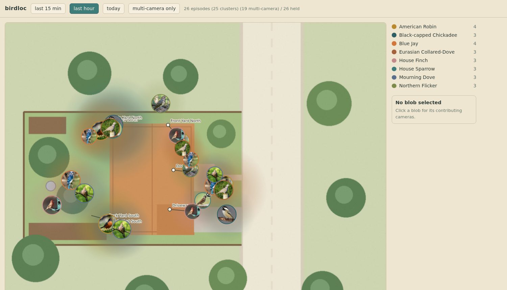

# birdnet-loc

**Where in the yard was that bird?** birdnet-loc listens to a [BirdNET-Go](https://github.com/tphakala/birdnet-go)
instance fed by several microphones (security cameras, in the original deployment). Each camera that heard
the call estimates how far away the bird was from how loud it sounded, and the bird is placed at the
loudness-weighted average of those positions, with the spread between them as the uncertainty. The result is
drawn over a top-down map of your yard.

*The example map with seeded episodes. Camera positions are the white dots; each circle's fade is the
position uncertainty, and clicking one lists the cameras that heard it and how loudly.*

## Quick start

You need a running BirdNET-Go with at least two RTSP (or other) audio sources whose names you know, and a
north-up image of the area they cover.

1. Copy `example/map/` somewhere, replace `map.png` with your own image and edit `cameras.yaml`: one entry
   per BirdNET-Go source, with its pixel position, the compass bearing it faces, and the image scale in
   metres per pixel. The file's comments explain every key. Source names must match BirdNET-Go's `source`
   field exactly.
2. Run it:

       cp .env.example .env            # BIRDNET_URL, MAP_DIR, lat/lon, ...
       docker compose up -d --build
       open http://localhost:9522      # the live map

   or without Docker:

       uv sync --group dev && uv run pytest -q
       BIRDNET_URL=http://localhost:8080 MAP_DIR=./example/map DATA_DIR=/tmp/birdnet-loc \
         uv run uvicorn birdnet_loc.web:app --port 9522

Estimates appear as soon as BirdNET-Go confirms a species on one of the cameras that heard it. The range
model self-calibrates per species, so positions tighten over the first few days.

## Configuration

Everything is read from the environment (`birdnet_loc/config.py`); `docker-compose.yml` lists each knob with
its default and the reason for it. The ones you will actually set:

| Variable | Default | Meaning |
| --- | --- | --- |
| `BIRDNET_URL` | `http://birdnet-go:8080` | Your BirdNET-Go base URL. |
| `MAP_DIR` | `/map` | Directory holding `map.png` and `cameras.yaml`. |
| `DATA_DIR` | `/data` | Writable: the SQLite store and photo cache. |
| `CONFIRM_MIN_CONF` | `0.7` | Confidence floor; keep it equal to BirdNET-Go's `birdnet.threshold`. |
| `TZ` | `America/Denver` | Timezone for the "today" window. |

The sections below describe how the tool actually works, in the order the data flows. Coding agents
setting the tool up should start with `SETUP.md`; agents changing the code should read `AGENTS.md`.

## Song bands

`bands.yaml` maps each species to the frequency range of its song, so loudness is read from the
1/3-octave bands the bird actually sings in rather than from the whole spectrum. Unknown species use
`default`. The table is maintained by hand; [`docs/bands.md`](docs/bands.md) explains how to pick a range
and `bands-tool` checks it:

    uv run bands-tool check                                    # validate, show the bands each range selects
    uv run bands-tool missing --birdnet-url http://host:8080   # species heard that have no entry yet
    uv run bands-tool keys 1600 3100                           # which 1/3-octave bands a range covers
    uv run bands-tool add "Blue Jay" 1600 3100                 # append an entry

The file is baked into the image, so after editing it run `docker compose up -d --build`. `BANDS_YAML`
overrides the path.

## How it works

**Events come from the `pending` SSE stream only.** Confirmed `detection` events (and the
`detections` table) are already de-duplicated by BirdNET-Go to one camera per bird, so they can
never describe a multi-camera event; `pending` snapshots list every camera hearing a species.
An episode is a species whose `firstDetected` is within `WINDOW_SECONDS` of an already-open
episode of that species (tolerance matching, not fixed buckets: one bird's per-camera
`firstDetected` values differ by a second or two). It closes after `CLOSE_AFTER_SECONDS` of
absence or `MAX_EPISODE_SECONDS`, and never reopens once closed.

**The confirmation gate.** An episode is emitted only once BirdNET-Go has *confirmed* that
species with `confidence >= CONFIRM_MIN_CONF` (0.7, = `birdnet.threshold`) on one of the
episode's own cameras, in a `detection` event overlapping the episode's window — the SSE
detection stream is not threshold-filtered, so the gate applies the threshold itself. An
episode that closes unconfirmed waits `CONFIRM_GRACE_SECONDS` (20 s) and is then discarded and
counted in `/health.unconfirmed_dropped`; the confirming confidence and camera reach the estimate as
`confirmed_conf` / `confirmed_by`. Confidence is a gate, never a weight.

Each contributing camera is weighted `hits x band x dir`, and its **range** along the bearing
comes from loudness: `range = REF_RANGE_M x 10^((ref_db - band_db)/20)`, clamped to
`[MIN_RANGE_M, MAX_RANGE_M]`, where `ref_db` is the 95th percentile of that species' observed
band levels (self-calibrated, `calib` table, `CALIB_MIN_N` samples before it is trusted;
`FALLBACK_RANGE_M` until then).

**Species photos** are 192x192 centre-cropped thumbnails drawn in the middle of each estimate
(one per species per 8 px cell, with a `xN` badge when episodes stack). Sources, in order:
BirdNET-Go's `GET /api/v2/media/image/<scientific name>`, then Wikipedia's REST
`page/summary` lead image (scientific name, then common name). Fetching happens only on a background worker, never in a request;
results are cached as PNGs in `DATA_DIR/photos/<slug>.png` and misses are retried after 24 h.

**History is only what this tool itself recorded** in `birdnet-loc.db` — there is no backfill, and
BirdNET-Go's own SQLite is never opened.

## Origins and licence

birdnet-loc was built for one backyard's BirdNET-Go node, fed by the audio of its Reolink security cameras. It is MIT licensed (see `LICENSE`).
The upstream BirdNET-Go project is unmodified and is not part of this repository.
